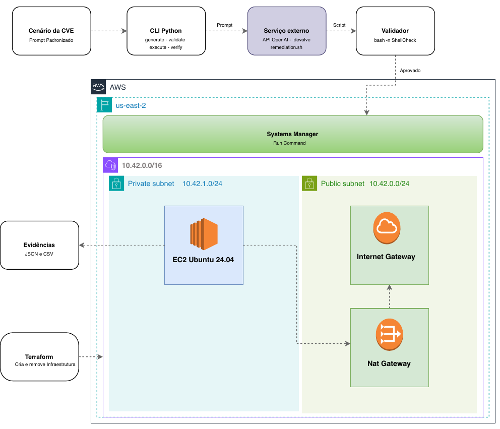

# Uso da inteligência artificial generativa na geração e validação de scripts de remediação para Linux

Trabalho de Conclusão de Curso em Sistemas de Informação. O laboratório está em [`tcc-gpt-linux/`](tcc-gpt-linux/).

## Contextualização

A correção de uma vulnerabilidade em um pacote Linux pode ser descrita como um script de atualização. Este projeto observa se um modelo de linguagem, consultado pela API da OpenAI, produz um script Bash aceitável para essa correção e se esse script, depois de uma validação estática, altera a versão do pacote em uma instância Ubuntu isolada.

## Problema

Um script gerado por um modelo pode estar sintaticamente errado, atingir outro pacote ou conter comandos fora do escopo. Executá-lo direto em um sistema impede saber se a mudança veio do script e se a versão instalada passou a atender o mínimo documentado pela distribuição.

## Objetivo

Gerar, validar e, somente quando o script é aprovado, executá-lo, conferindo o resultado por uma verificação independente da versão do pacote. O caso apresentado no TCC é a CVE-2024-38428, no pacote `wget` do Ubuntu 24.04.

## Tecnologias

- Python 3.11 ou superior, na interface de linha de comando
- API da OpenAI, somente na geração do script
- Bash, `bash -n` e ShellCheck
- Terraform 1.6 ou superior
- AWS em `us-east-2`: VPC, EC2, NAT Gateway e Systems Manager Run Command
- Ubuntu 24.04 LTS

A chave da API permanece no ambiente local. Ela não é gravada neste repositório.

## Arquitetura



A figura usada no TCC está em [`tcc-gpt-linux/docs/arquitetura/figura-projeto-tcc.png`](tcc-gpt-linux/docs/arquitetura/figura-projeto-tcc.png). O PDF de origem está em [`ProjetoTCC.pdf`](tcc-gpt-linux/docs/arquitetura/ProjetoTCC.pdf). A leitura acompanhada está em [`descricao_arquitetura.md`](tcc-gpt-linux/docs/arquitetura/descricao_arquitetura.md).

O cenário entrega um prompt padronizado à CLI Python. A CLI envia o prompt à API, que devolve `remediation.sh`. O validador aplica `bash -n` e o ShellCheck. No código existe um terceiro nível, um checklist de segurança e de adequação ao pacote alvo; o rótulo da figura nomeia os dois primeiros. Somente o script aprovado segue para o Systems Manager.

Na AWS, a região usada foi `us-east-2`. A VPC `10.42.0.0/16` separa a sub-rede pública `10.42.0.0/24`, com Internet Gateway e NAT Gateway, da sub-rede privada `10.42.1.0/24`, onde fica a EC2 Ubuntu 24.04 sem IP público. A saída da instância passa pelo NAT, necessário para o agente do Systems Manager e para o `apt`. O Terraform cria e remove essa pilha. As evidências ficam no ambiente local, em JSON e CSV.

Itens definidos no Terraform e não desenhados na figura: security group sem regra de entrada, volume gp3 criptografado, IMDSv2 e papel IAM limitado a `AmazonSSMManagedInstanceCore`. Não há SSH.

## Fluxo de funcionamento

1. `generate` monta o prompt do cenário e grava o script, o texto devolvido e o metadado.
2. `validate` executa `bash -n`, ShellCheck e o checklist. Erro de sintaxe, erro do ShellCheck ou falha do checklist reprovam o script. Aviso e informação do ShellCheck ficam registrados e não reprovam.
3. Script reprovado não é enviado ao Systems Manager.
4. `execute` envia o script aprovado por SSM Run Command e exige uma frase de autorização.
5. `verify` consulta a versão instalada com `dpkg`, fora do texto produzido pelo modelo.
6. `report` relê somente arquivos já gravados e monta tabelas e gráficos. Não chama a AWS nem a API.

## Estrutura de diretórios

```text
tcc-gpt-linux/
  src/                 CLI, cliente da API, validador, SSM e reexecução
  tests/               testes locais, sem serviços externos
  terraform/           VPC, NAT e EC2
  prompts/             modelo do prompt de remediação
  scenarios/           fichas dos candidatos e scripts do caso executado
  generated_scripts/   scripts e metadados das chamadas à API
  results/             métricas, gráficos e reexecuções
  evidence_archive/    cópia congelada do conjunto histórico do wget
  docs/                método, resultados, limitações e a figura
```

## Pré-requisitos

- Python 3.11 ou superior
- Terraform 1.6 ou superior, para criar ou destruir a pilha
- ShellCheck disponível no PATH
- AWS CLI, apenas para as operações que usam a conta
- `OPENAI_API_KEY` no ambiente, apenas para `generate`

## Configuração e execução

No diretório `tcc-gpt-linux`:

```bash
python3 -m venv .venv
. .venv/bin/activate
pip install -r requirements.txt
python -m src.main check
pytest
```

`check` e `pytest` não acessam a AWS nem a OpenAI.

Os comandos abaixo fazem parte da CLI. `provision`, `execute` e `cleanup` criam, executam ou destroem recursos pagos e só continuam com a frase de autorização correspondente. A leitura das evidências já coletadas não depende desses comandos.

```bash
python -m src.main generate --cve CVE-2024-38428
python -m src.main validate --cve CVE-2024-38428
python -m src.main execute --cve CVE-2024-38428 --authorize AUTORIZO_EXECUCAO_SCRIPT_IA
python -m src.main verify --cve CVE-2024-38428
python -m src.main report
```

O valor padrão de modelo em `src/config.py` é `gpt-4o-mini`, usado quando a variável de ambiente não define outro. Esse padrão não é o registro do experimento. O campo `model` de cada `metadata.json` guarda um único identificador: o cliente não separa o modelo pedido do modelo devolvido, e o corpo da resposta da API não foi armazenado. Nas três gerações que produziram script, esse campo tem o mesmo valor. A repetição 1 pediu `gpt-4.1`, recebeu HTTP 429 e não produziu script. A temperatura 0,2 está no cliente e aparece de forma explícita apenas no registro de status da repetição 2.

## Experimento apresentado no TCC

O caso é a CVE-2024-38428, pacote `wget`, Ubuntu 24.04. A versão vulnerável observada foi `1.21.4-1ubuntu4`. O mínimo oficial usado pelo laboratório é `1.21.4-1ubuntu4.1`. Depois da execução, a versão observada foi `1.21.4-1ubuntu4.5`.

No conjunto histórico houve quatro chamadas à API. Três devolveram scripts diferentes, nas repetições 2, 3 e 4. As três passaram na validação que autorizou a execução, e as três execuções pelo Systems Manager terminaram com sucesso. A primeira validação da repetição 2 tinha reprovado o mesmo arquivo. O `validation.json` conservado é o da segunda passagem. A reprovação permanece no ledger.

Na tarde de 12 de novembro de 2026, os três scripts originais foram executados de novo, sem nova chamada à API, cada um em uma EC2 nova. O conjunto que usou `file://` ficou classificado como FALHA. O conjunto HTTP ficou classificado como SUCESSO nas três repetições. O teste HTTP não explora a CVE e não demonstra mudança de comportamento do `wget`: a resposta foi a mesma antes e depois da atualização. A classificação SUCESSO exige, juntas, a versão mínima e essa resposta HTTP.

A CVE-2024-32487, no pacote `less`, também foi executada nesse dia. Os três scripts falharam no Systems Manager e a classificação gravada é FALHA. Esse experimento não integra os resultados apresentados na versão atual do TCC. Os arquivos originais estão na tag `archive/experimento-cve-2024-32487`, no commit `4cb0d28`. A ficha permanece em `tcc-gpt-linux/scenarios/CVE-2024-32487/`. As demais fichas de candidatos também permanecem em `tcc-gpt-linux/scenarios/`.

## Evidências experimentais

O conjunto histórico do `wget` está nos commits `82b6270`, `a182465` e, para as duas reexecuções, `d7b95f9`.

- Scripts, metadados e verificações: `tcc-gpt-linux/generated_scripts/CVE-2024-38428/rep01` a `rep04`. A repetição 1 não tem script. `verify_independent.json` existe na repetição 2 e não existe nas repetições 3 e 4.
- Ledger: `tcc-gpt-linux/results/experiments.json`
- Reexecução com `file://`, classificada como FALHA: `tcc-gpt-linux/results/reexecution/CVE-2024-38428/`
- Reexecução HTTP, classificada como SUCESSO: `tcc-gpt-linux/results/reexecution/CVE-2024-38428-http/`
- Cópia congelada anterior à auditoria metodológica: `tcc-gpt-linux/evidence_archive/historical-cve-2024-38428/`

Os JSON, os logs e os scripts dessas pastas são os registros originais. Em `evidence.md` da reexecução HTTP, a frase que atribuía o teste funcional apenas a `file://` foi corrigida. Os JSON não foram alterados.

## Resultados e limitações

No conjunto histórico, a sintaxe dos três scripts foi aprovada, o ShellCheck não registrou erro bloqueante e a versão subiu nas três execuções. A chamada sem script entra no denominador das chamadas à API, não no dos scripts. As taxas estão em `tcc-gpt-linux/results/summary.csv` e nos gráficos de `tcc-gpt-linux/results/charts/`.

Limitações registradas no trabalho:

- um caso apresentado, um pacote e três scripts executados
- a redução de esforço manual não foi medida e não há comparação entre modelos
- o metadado não distingue o modelo pedido do modelo devolvido
- a primeira validação da repetição 2 não tem `validation.json` próprio
- o conjunto histórico reutilizou uma EC2; pelo protocolo posterior, a classificação desse conjunto é INCONCLUSIVO, embora a versão tenha sido corrigida
- o teste HTTP não cobre todas as funções do `wget`
- a pilha e a AMI privada foram destruídas depois da coleta

Leitura complementar, no laboratório: [`docs/metodologia.md`](tcc-gpt-linux/docs/metodologia.md), [`docs/resultados_tcc.md`](tcc-gpt-linux/docs/resultados_tcc.md), [`docs/reexecucao_resultado.md`](tcc-gpt-linux/docs/reexecucao_resultado.md), [`docs/modelo_ia.md`](tcc-gpt-linux/docs/modelo_ia.md) e [`docs/limitacoes.md`](tcc-gpt-linux/docs/limitacoes.md).
